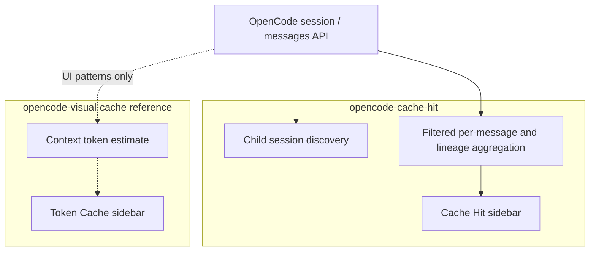
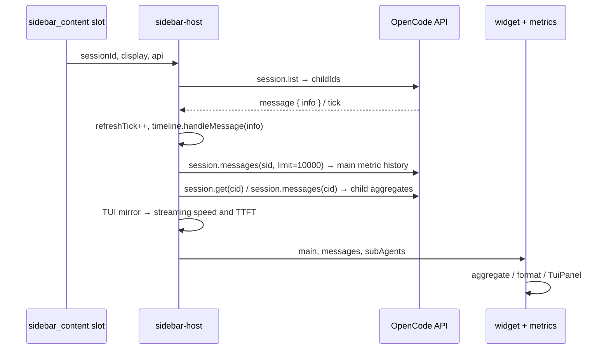
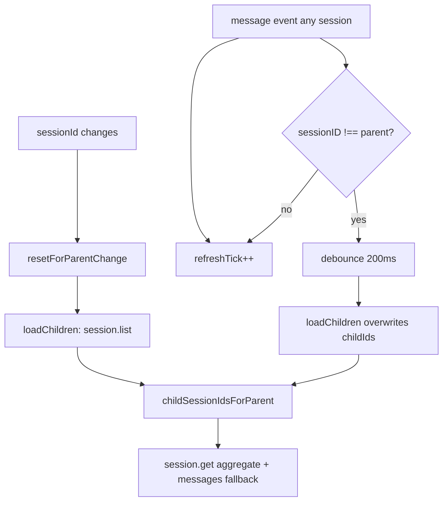

# Design

For **maintainers** of this plugin: data flow, refresh rules, and boundaries vs [opencode-visual-cache](https://www.npmjs.com/package/opencode-visual-cache). User setup: [README.md](../../README.md).

## Relationship to opencode-visual-cache

This is a **separate project**, not maintained by the visual-cache authors. It **borrows heavily** from [opencode-visual-cache](https://www.npmjs.com/package/opencode-visual-cache):

- **Sidebar panel layout** (`src/tui-panel/`): borders, hit bar, foldable sections, theme palette mapping
- **Layout**: main session block always visible; collapsible **Agents** section when sub-agents exist
- **Hit rate convention**: session totals align with visual-cache’s `cache.read / (cache.read + input)` rule

**Division of labor**: visual-cache focuses on **main-session context / token distribution estimates**; cache-hit focuses on **per-turn metrics, cost, and sub-agent aggregation**. Install both for a complete picture.

See the [documentation index](../README.md).

## Product boundary



| Role | Responsibility |
|------|----------------|
| **cache-hit** | Sub-agent discovery and rollup; cache, tokens, cost for main/child sessions |
| **visual-cache** | Main-session context and estimates; not maintained in this repo |
| **Default** | Main block + foldable **Agents** (child-session totals) |

## Cost model

- OpenCode: `msg.cost` accumulates assistant messages using **USD** list prices from `opencode.json`.
- Plugin: `createCostFormatter(loadPluginConfig().cost)`; default `costUnit: USD` → `currency: CNY`, `rate: 6.77`.
- Config file: `~/.config/opencode/cache-hit.json` (preferred) or `cache-hit.config.json` at plugin root (legacy). Defaults in `plugin-config.ts`.
- Interactive metrics exclude messages with `summary: true` or `agent: "compaction"`.
- Main-session lineage metrics group direct-history messages by `providerID:modelID`. Missing metadata uses the `unknown` bucket.
- Mixed-model cost, read savings, write premium, and net cache value use each message's provider/model rates. If any message has no matching rate, the cost row keeps OpenCode's reported blended cost.

## Dynamic pricing (`dynamicPricing`)

Two orthogonal price dimensions resolve to the effective per-1M rates shown in the sidebar:

- **Context tier**: reads the runtime cost tiers from `state.provider` (`tiers[]` / `experimentalOver200K`, normalized into the internal context tier with its own threshold); picks the tier by total context (`input + cacheRead`) vs the threshold (per-model config > runtime tier size > global > 200k). Zero-config for models like GPT-5.6.
- **Time-of-day tier**: `schedule` (default DeepSeek peak Mon–Fri 09:00-12:00 / 14:00-18:00 Beijing, off-peak otherwise) + per-model `multipliers` (default DeepSeek off-peak 0.5×) or absolute `levels` (level miss falls back to static rates; `enabled: false` restores fully static pricing). Windows may carry an optional `days` list (ISO 1=Monday…7=Sunday; omitted = every day); a level with empty `windows` is the **catch-all fallback** (e.g. the default `offpeak`, which covers weekends). Cross-midnight windows anchor to their open day (evening part on `days` day, morning part on the next day).

Lookup fallback chain (`src/dynamic-pricing/lookup.ts`): explicit `levels` → explicit `multipliers` → built-in DeepSeek default → static `state.provider` cost.

- `src/dynamic-pricing/schedule.ts`: timezone-aware window matching (`Intl.DateTimeFormat`), `nextBoundaryMs` drives a `setTimeout`-based refresh in `use-cache-hit-metrics.ts` — no polling.
- Session cost recompute (`src/dynamic-pricing/recompute.ts`): per message, `msg.time.created` selects the tier, total context (`input + cacheRead`) the context tier; `tokens.input` excludes cache, so cache reads are billed separately at `cacheReadRate`.
- Sub-agents: `session.list` entries carry `time.created` (`src/session-list.ts` → `child-session-sync.ts`), so each child's cost can be recomputed at its creation time (`recomputeSubAgentCost`).
- Timeline dashboard (`scripts/timeline-dashboard.ts`): offline recompute reads provider rates from `~/.config/opencode/opencode.json` (JSONC-aware) and injects `dynCost` per `LlmCallRecord` (shown with `≈`, counted in charts/totals).

## Runtime architecture



### Module map

| File | Role |
|------|------|
| `plugin.tsx` | Dual entry: V1 `tui(api)` + V2 `setup(ctx)`; load config and formatters |
| `types.ts` | Internal `TuiApi` / `TuiEvent` contract shared by both versions |
| `v1-map.ts` | V1 legacy `{ properties }` events and SDK wire format (`{ path, query }` / `{ data }` envelopes) → internal contract (pure, tested) |
| `v2/adapter.ts` | V2 context/events → internal contract |
| `sidebar-host.tsx` | Bind `sessionId`; direct main history; `mainSnap` / `mainMessages` / `subAgentList`; `refreshTick` + message/tick events |
| `widget.tsx` | Render panel when `sessionId` set; `noData` when empty |
| `use-cache-hit-metrics.ts` | Hit row, trend, main block visibility |
| `main-session-view.tsx` / `agents-view.tsx` | Business sections |
| `cache-hit-rows.tsx` | Shared token rows in Detail |
| `stats.ts` | Pure aggregation (no UI) |
| `session-messages.ts` | Main-session history loader over the typed client contract and source status |
| `lineage-stats.ts` | Provider/model lineage buckets and active-lineage selection |
| `pricing.ts` | Per-message mixed-model cache value calculations |
| `cache-ttl.ts` / `cache-ttl-view.tsx` | Independent TTL activity per lineage |
| `session-list.ts` | Parse `session.list`, `childSessionIdsForParent` |
| `format-cost.ts` / `format-tokens.ts` / `format-cache-ui.ts` | Display formatting (`computeHitBarWidth` lives in `tui-panel/layout.ts`) |
| `format-model.ts` | Sub-agent row label (`formatSubAgentLabel`) and vendor brand colors (`modelRowColor`) |
| `message-timing.ts` | SDK time fields |
| `token-speed.ts` / `streaming-state.ts` | Speed calculations & streaming phase state machine |
| `timeline/` | Per-call JSONL (`records` / `writer` / `collector`) |
| `plugin-config.ts` / `load-config.ts` | Config normalization |

### Version support

One package serves OpenCode 1 and OpenCode 2 from a single default export in `src/plugin.tsx`:

| Version | Entry | Slot |
|---------|-------|------|
| V1 | `tui(api)` | `sidebar_content` (`order: 56`) |
| V2 | `setup(ctx)` | `sidebar.content` |

- V2's CLI loader calls `setup(ctx)` and ignores `tui`; V1's TUI loader calls `tui(api)` and ignores `setup`.
- `exports["."]` is a no-op V2 server entry (`src/v2/server.ts`), so the package loads from `opencode.json` and V2 reports `features.tui` before mounting the sidebar.
- `src/v2/adapter.ts` maps the V2 context onto the internal `TuiApi` / `TuiEvent` contract (`src/types.ts`); pure mapping lives in `src/v2/map.ts` and is unit-tested without a running OpenCode. V1's legacy event payloads are mapped onto the same contract in `src/v1-map.ts`.
- V2 has no message-level stream event: one step is one assistant message, so the adapter synthesizes `message` events from `session.step.started` plus the terminal `session.step.ended` / `session.step.failed` (the store row supplies the compaction `summary` flag).
- V2 plugins run on OpenCode's bundled OpenTUI (`0.6.6` in current releases). Keep the `@opentui/*` peers at `>=0.6.6`: older builds register `OPENTUI_FORCE_WCWIDTH` with a conflicting type in OpenTUI's `globalThis` env registry, and plugin load aborts.
- Local directory installs resolve `<dir>/server` / `<dir>/tui` instead of `package.json` exports; the root `server.ts` / `tui.ts` shims forward to the no-op server entry and the built bundle. Package-name installs use `exports`.
- Since 1.0.0 only the V2 path is officially supported and tested; the V1 path is best-effort.

### Event mapping

The internal contract (`TuiEvent` in `src/types.ts`) is version-neutral; each entrypoint owns its own translation:

| Internal | V1 source (`tui(api)`) | V2 source (`setup(ctx)`) | Notes |
|----------|------------------------|--------------------------|-------|
| `part` | `message.part.updated` (`properties.part`) | `session.text.started`, `session.reasoning.started`, `session.tool.input.started`, `session.tool.success` / `failed` | V2 splits a tool call across events (callID/name/start/end); only V1 reports `state.status = "pending"`, used for pure-tool-call TTFT |
| `message` | `message.updated` (`properties.info`) | `session.step.started` + `session.step.ended` / `session.step.failed` | One step is one assistant message; the store row contributes the compaction `summary` flag. A failed step has no `finish`, so it maps to `"error"` as V2 projects it |
| `delta` | `message.part.delta` (`{ messageID, field }`) | `session.text.delta`, `session.reasoning.delta` | First chunk provides the TUI-side TTFT fallback and ITL intervals; V1's `field: "tool"` deltas are dropped on purpose (tool parts carry their own timestamps) |
| `tick` | `message.updated` without `info` | `session.usage.updated` | Refresh only (re-read `session.get()`); carries no message |

- V2 has no message-level stream event; `session.text.ended` / `session.reasoning.ended` overwrite the accumulated deltas in the adapter's parts cache (the authoritative full value).
- The host-event surface is one table in `src/v2/adapter.ts`; each of its names must have a payload case in `tests/fixtures/v2-events.ts`. A case delivers host payloads in order and pins the internal events they must produce, in full — so changing which payload field the adapter reads (e.g. `created` → `data.timestamp`) turns that case red. Those payloads are **assumed, not captured**: the host's own timeline output confirms the four fields the adapter depends on (`created`, delta message identity, tool `id`/`name`, `step.ended` `assistantMessageID`), and the event names are confirmed by scanning the shipped OpenCode 2.0.32 CLI binary (every name below is present, and the SDK bus schema's `session.next.*` namespace is absent there). The `step.started` metadata fields and the failure/deletion events are still unconfirmed by observation. A real capture replaces them; they are not evidence about the host.
- `session.message.content.updated` exists in the host (its name is in the 2.0.32 binary) but the adapter does **not** subscribe to it. It only ever carried a full content snapshot on replay, and handling it would only refresh part timestamps for a replayed message; until a capture shows it actually firing, the missing handler costs at most TTFT on replays, never correctness.
- `api.state.part()` is a host API on V1; on V2 the adapter keeps the same view in a bounded cache (200 messages).
- V2 history reads go through the generated client (`message.list` in 200-row cursor pages up to the caller's limit). A missing client or a failed first page falls back to the TUI store window; that window is filled by the host one page at a time (20 rows in current builds), so a populated window is always reported incomplete — the plugin contract exposes no cursor, and the row count is not a usable proxy. An empty window first waits for the one in-flight `message.sync` (nothing re-reads the store after it lands), so an empty result means either a genuinely empty session (`complete`) or a failed sync (`incomplete`).
- A plugin hot reload destroys the sidebar host and the adapter, so an in-flight message loses the part events that fed the trackers. `step.ended` therefore replays the message's timed parts from its store row before emitting `message` (see [ttft-hybrid.md § Store replay](./ttft-hybrid.md)); text parts have no stored timestamp, so a reply that opens with text cannot recover TTFT that way (only the first content part may seed it).
- `message` always carries `sessionID`: V1 reads it from the info, V2 from the step event.

### TUI panel framework (`src/tui-panel/`)

Reusable **page** skeleton aligned with visual-cache (layout, colors, foldable sections)—no skills estimate, slash, or kv business logic.

| Module | Role |
|--------|------|
| `layout.ts` | Column widths, `justifyRow`, `computeHitBarWidth`, separators |
| `palette.ts` | Theme → panel palette; `toneBrandHex` for vendor colors on dark panels |
| `use-panel-layout.ts` | `createPanelLayout`, `createSectionFold` |
| `components.tsx` | `TuiPanel`, `TuiHitRow`, `TuiMetricRow` (`labelFg` / `valueFg` split colors), … (`@opentui/solid`) |
| `index.ts` | Barrel export |

Import `layout.ts` / `palette.ts` directly from non-JSX code (e.g. `use-cache-hit-metrics`) so `bun test` smoke tests do not pull JSX.

See [src/tui-panel/README.md](../../src/tui-panel/README.md) · [中文](../../src/tui-panel/README.zh-CN.md).

## Sub-agent discovery

Implementation: `src/child-session-sync.ts` (used by `sidebar-host`).



- **Single source of truth**: `childIds` always **replaced** from `session.list` (no `session.get` append).
- **Races**: `listGen` increments on parent change; callbacks check generation and `parentId`.
- **Streaming**: foreign-session `message` events are debounced (`CHILD_LIST_DEBOUNCE_MS` = 200ms).
- **Depth**: direct children only (`parentID === sid`); nested sub-agents are future work.
- **Data**: `session.get(cid)` → `aggregateFromSessionObject` (primary); falls back to `messages(cid)` → `aggregateSessionFromMessages`. Model/provider metadata is patched from messages when missing from session aggregates (`withModelFallback`).

### Agents block semantics

| Scope | Included in Agents total? |
|-------|-------------------------|
| Each child session’s assistant messages | Yes (`aggregateSubAgents`) |
| Main session assistant messages | **No** (still in `mainSnap` when hidden in UI) |

The UI shows `agentsScopeHint` (“sub-sessions only”). This complements visual-cache’s main-session view—it is not a missing-aggregation bug.

### Sub-agent row display

When multiple child sessions run in parallel, each active sub-agent gets a metric row under **Agents** (see screenshot `docs/assets/cache-hit-panel.v4.png`).

| Aspect | Behavior |
|--------|----------|
| **Purpose** | Distinguish which child session and which model in a narrow sidebar |
| **Label text** | `{displayModelName} …{sessionIdTail}` — same naming rules as the main **Model** row (`shortModelName` + date-suffix strip); **no** semantic nicknames (`ds-flash`, etc.) |
| **Truncation** | `gauge` ≈ measured panel width − border gutter; label budget subtracts right-side cost/tokens. Prefer keeping the **model prefix**; shrink ID tail (6 → 4 chars) before dropping the tail |
| **Label color** | Approximate **vendor brand** hex (`MODEL_BRAND_HEX` in `format-model.ts`), passed through `toneBrandHex` for legibility on dark terminals |
| **Value color** | `muted` — separate from label so row cost is not confused with Agents total **Cost** (`success` green) |
| **Family match** | `MODEL_FAMILY_RULES` (claude, deepseek, openai, gemini, qwen, glm, kimi, minimax, grok, mimo, meta, mistral); matching is **case-insensitive** on model slug and `providerID` |
| **Unknown models** | Stable hash → neutral fallback hues (never `success`) |
| **Config** | No `cache-hit.json` keys in v1; extend `MODEL_FAMILY_RULES` / `MODEL_BRAND_HEX` in code |

Implementation: `agents-view.tsx` calls `formatSubAgentLabel` + `modelRowColor`; `TuiMetricRow` uses `labelFg` / `valueFg`.

## Aggregation and refresh

### When values recompute

| Data | Trigger |
|------|---------|
| Main metric history | Direct `session.messages(sid, limit=10000)`; fallback to the TUI mirror — `unavailable` once the 100-message mirror fills, `capped` when the direct history hits 10k |
| Main fast messages | `createMemo` reads `refreshTick` + the TUI mirror for streaming speed and TTFT |
| Main snapshot fallback | `session.get?.(sid)` aggregate, then the TUI mirror |
| Sub-agent content | `refreshTick` + `childIds` → `session.get?.(cid)` per child; fallback `messages(cid)` |
| Sub-agent ids | `session.list` callback / debounced refresh on foreign activity |

`sidebar-host` subscribes to `message` / `tick` and bumps `refreshTick` so dependent memos recompute. Main metric totals prefer the DB-level `session.get` aggregate (complete, not capped); lineage buckets use direct history. Streaming speed and TTFT use the TUI mirror. Child totals use `session.get()` when available.

### session.get() availability

`session.get()` provides DB-level aggregates (not capped at 100 messages), but was added in [opencode#26644](https://github.com/anomalyco/opencode/pull/26644) (2026-05-12). Forks that split before this commit — including MiMo-Code — lack the method. The main metric path prefers the DB-level `session.get` aggregate; when it is absent or empty it requests direct session messages with a 10,000-message limit. If that request fails once the mirror has filled its 100-message cap, the source is marked `unavailable`; a returned history at the 10,000 limit is marked `capped`. The mirror itself contains at most the 100 most recent messages per call.

### Accumulation rules

- Every eligible `role === assistant` message in the session is included—not only the last turn.
- Streaming updates the same message’s `tokens` repeatedly.
- `reasoning` tokens are **excluded** from hit-rate denominator.
- `summary: true` and `agent: "compaction"`: excluded from interactive totals, speed, pricing, trend, and TTL selection.

### Sidebar visibility

```mermaid
flowchart TD
  M{child session?<br/>session.parentID set}
  M -->|yes| NC[slot never called]
  M -->|no| V{visible?<br/>toggled open, or width > 120<br/>with state "auto"}
  V -->|no| NC
  V -->|yes| S{sessionId set?}
  S -->|no| H[no panel]
  S -->|yes| P[TuiPanel]
  P --> D{hasData?}
  D -->|no| ND[noData]
  D -->|yes| MAIN[Main / Detail / Model / Models]
  D -->|has subs| AG[Agents (foldable)]
```

| Concept | Implementation |
|---------|----------------|
| Sidebar **mounted** | Not ours: OpenCode renders the sidebar only when the session has no `parentID` **and** either the user toggled it open, or the terminal is wider than 120 columns **and** the persisted state is `auto` (not `hide`). Otherwise this plugin's slot is never called (README § Compatibility) |
| Whole panel | `widget.tsx`: `Show when={sessionId().length > 0}` |
| Has data | `lineages.length > 0 \|\| subs.length > 0` |
| Main **block** | Always rendered |
| **Agents** | Shown when `subs.length > 0`; foldable |

## Hit rate (current)

**Active lineage total (Total Hit)**

```
Sum input and cache.read over eligible assistant messages in the active provider/model lineage
→ cacheRead / (cacheRead + input)
```

The foldable **Models** section shows one cache ratio and call count per recent lineage. The previous mixed-session aggregate remains available internally for cost fallback, but it is not labeled as the active model's total.

**Header Hit (per-turn + trend)**

- `computePerCallHitTrend`: one rate per eligible assistant turn; skip summary and compaction messages.
- Display `switch` after a lineage change, `warming` for the first eligible call, then compare only same-lineage calls for ↑ / ↓ / `-`.

**Pricing & Saved**

- Provider pricing is read from `api.state.provider` (SDK runtime data, not hardcoded).
- `computePricing` looks up active-lineage per-million rates by `providerID` + `modelID`.
- `computeSessionPricing` sums each message's input, cache-read, cache-write, and output rates. Detail shows read savings, write premium, and net cache value.
- Main session cost uses the dynamic per-message result when dynamic rules apply and all eligible messages have rates; otherwise it uses the blended OpenCode message cost.
- Agents section: **Saved** row sums savings across all child sessions (`computeSubsSaved`).
- All pricing rows hidden when rates are unavailable or saved is zero.

## Time fields (OpenCode SDK v2)

| Source | Field | Notes |
|--------|-------|-------|
| `AssistantMessage` | `time.created` | ms epoch |
| `AssistantMessage` | `time.completed?` | end of LLM turn; often missing while streaming |
| `ReasoningPart` | `time.start` / `time.end?` | thought segments |
| `ToolStateCompleted` | `time.start` / `time.end` | tool run |
| `StepFinishPart` | (no time) | tokens/cost; time falls back to message |

**Per-call JSONL (Phase 1, default off)**: one row per assistant turn; daily file under `logs/`. See **[timeline.md](./timeline.md)** § Storage, § Rotation and retention.

## Testing

| Layer | Files | Purpose |
|-------|-------|---------|
| Unit | `tests/*.test.ts` | `stats`, `format-*`, layout, timeline |
| Smoke | `tests/module-load.test.ts` | Real import graph |
| Runtime | OpenCode logs | JSX / peer load errors |

After moving exports: `rg` + `bun test`.

## Roadmap (not implemented)

| Item | Notes | Doc |
|------|-------|-----|
| Per-call JSONL | **Phase 1 done** (`src/timeline/`, default off) | [timeline.md](./timeline.md) |
| Metric modes | Session / last N / sliding window | timeline.md § Phase 3 |
| Sub-agents | Recursive children, filter by agent type | timeline.md § Risks |

Timeline writes must stay async and non-blocking (see timeline.md).

## Plugin cache

| Install | After code change |
|---------|-------------------|
| Local path | Restart OpenCode |
| npm package | Restart; clear `~/.cache/opencode/packages/opencode-cache-hit@latest` if needed |
