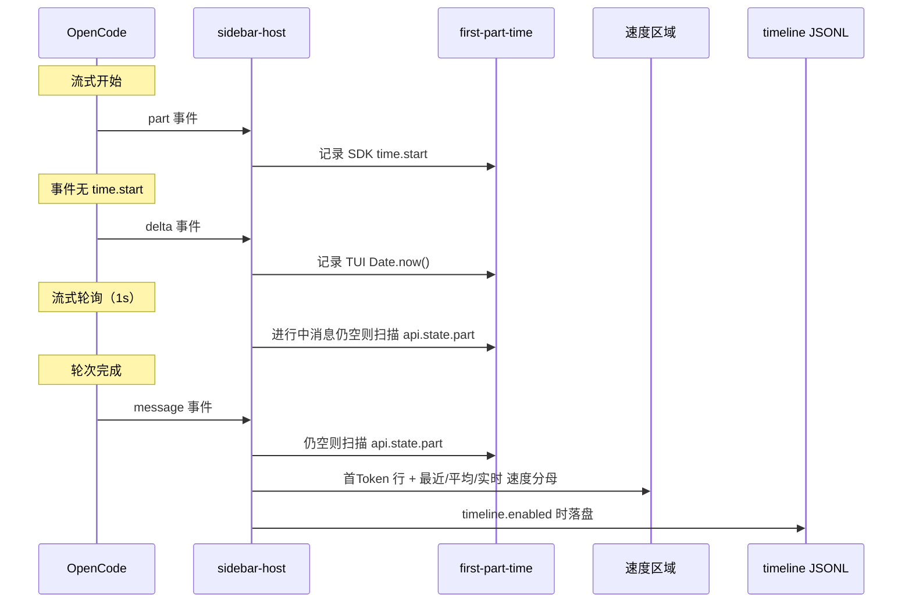

# TTFT 混合实现方案

本文档说明 opencode-cache-hit 如何在侧边栏 **速度** 区域（以及可选的 timeline JSONL，`timeline.enabled: true` 时）测量 **首 Token 延迟（TTFT）** 以及 **生成速度的分母**。

> **事件名**：本文使用插件内部事件契约（`src/types.ts` 的 `TuiEvent`）：`part` / `message` / `delta` / `tick`。OpenCode 1（`message.part.updated`、`message.updated` …）与 OpenCode 2（`session.text.started`、`session.step.ended` …）的源事件分别在 `v1-map.ts` / `v2/adapter.ts` 中映射到该契约，见 [design.md § 事件映射](./design.md#事件映射)。

## 背景

OpenCode 的 part 时序字段是可选的：

```typescript
type TextPart = {
  time?: { start: number; end?: number }  // 可选
}
```

`part.time.start` 常因 SDK 设计、provider 差异、代理、事件顺序或上游 bug（如 [#21544](https://github.com/anomalyco/opencode/issues/21544)）而缺失。插件因此组合多个数据源。

> **术语说明**：本文中 **"sdk"** 指 OpenCode SDK processor 层 —— 即首个流式 chunk 到达时 `part.time.start = Date.now()` 的记录位置，**并非** LLM provider API。**"tui"** 指 TUI 插件的 JavaScript 事件处理函数（`delta` 事件回调中的 `Date.now()`）。两者均为本地测量，均非 provider 侧数据。

**侧边栏 TTFT 始终采集**，由 `src/first-part-time.ts` 负责。**`timeline.enabled` 仅控制 JSONL 落盘**，不影响侧边栏行。

## 数据源（按优先级）

### 1. SDK 端时序（优先）

| | |
|--|--|
| **触发** | `part` 事件 |
| **字段** | `text` / `reasoning` part 的 `part.time.start` |
| **公式** | `ttftMs = part.time.start - msg.time.created` |
| **精度** | 最高 — 三个数据源中最早的时间戳（SDK 本地打点，不含到 TUI 插件的 IPC/事件循环延迟） |

### 2. TUI 端时序（兜底）

| | |
|--|--|
| **触发** | 首个 `field` 为 `text` 或 `reasoning` 的 `delta` 事件 |
| **字段** | 收到时的 `Date.now()` |
| **公式** | `ttftMs = Date.now() - msg.time.created` |
| **精度** | 含全链路延迟（provider 处理 + 互联网 + SDK 内部 + 本地 IPC + JS 事件循环）；依赖宿主正常投递流式增量 |

### 3. Part 状态扫描（兜底）

| | |
|--|--|
| **触发** | assistant 消息的 `message` 事件且尚无已存时间戳；以及 **实时** 流式期间每秒对进行中消息的轮询 |
| **字段** | `api.state.part()` 中 `text` / `reasoning` 最早的 `part.time.start` |
| **公式** | 与来源 1 相同 |
| **精度** | part 已持久化且带 `time.start` 时与 SDK 端等价 |

**`api.state.part()` 的作用**：V1 直接暴露 OpenCode 按消息维护的 part 状态。V2 没有这个宿主 API：adapter 维护一个有界缓存（200 条消息，由 `part` 事件填充，重启即丢失），所以扫描只覆盖仍在缓存里的消息。两种情况下，part 事件缺失或晚到时，`message` 事件都可以在这个视图里扫描最早的合法 `time.start`。仅当 parts 带时序数据时有效；部分后端（如无 parts 表的本地模型）仍无可用 `time.start` — 见 [ttft-troubleshooting.md](./ttft-troubleshooting.md)。

### 4. Store 回放（重载后兜底）

| | |
|--|--|
| **触发** | V2 的 `session.step.ended` / `step.failed`：在发出 `message` 事件之前，从该消息的 store 行 `content` 重新发出该消息的 part 事件 |
| **字段** | `content[*].time.created`（reasoning/tool；tool 用 `time.completed` 作 end） |
| **公式** | 与来源 1 相同 |
| **精度** | 与来源 1 等价（同一批 SDK 打点），只是晚一步到达 |

为什么需要：插件热重载（本地目录开发时每次 `bun run build` 改动 `dist/tui.js`，或插件更新正好发生在流式过程中）会销毁 sidebar host 与 adapter，进行中消息的 part 事件进了已销毁的 tracker，而 `step.ended` 落在新建的空 tracker 上。store 行保留了带时间的 part，于是重放一遍。

两个消费者都是幂等的（`firstPartTime` 已有 SDK 值时不覆盖，`toolTiming` 按 callID 去重），所以对正常消息是空操作，只补回丢失的部分。

**上限**：只有首个内容 part 可以播下 TTFT，而 store 里的 text part **不带时间**——以 text 开头的回复无法恢复 TTFT（下一个带时间的 part 更晚，用它只会把值报大）。未收尾的 tool（无 `time.completed`，如被中断的回合）按 `running` 重放，因此不会被编造出时长。`delta` 只在线上出现，ITL 不可恢复。这些情况留空。

## 优先级规则

同一消息上，SDK 端时间戳优先于 TUI 端。已有 SDK 端记录后，后续 TUI 端事件被忽略。若更晚到达有效的 SDK 端 `time.start`，可覆盖先前的 TUI 端值。

`start <= msg.time.created` 的时间戳会被丢弃（时钟偏差或异常 SDK 数据）。来源 4 的 store 回放在发出前执行同样的过滤，因为 `recordPart` 自身不负责拒绝异常打点。

逻辑位于 `createFirstPartTimeTracker()`（`src/first-part-time.ts`）。

## 数据流

`sidebar-host` 收到的是内部事件：V1 的 `message.part.updated` / V2 的 `session.text.started` 已由 `v1-map.ts` / `v2/adapter.ts` 映射。



## 模块分工

| 模块 | 职责 |
|------|------|
| `src/first-part-time.ts` | 按消息记录首 part 时间 |
| `src/sidebar-host.tsx` | 订阅 part / message 事件 |
| `src/use-cache-hit-metrics.ts` | `lastTtft`、**最近** / **平均** / sparkline 速度（已跟踪时用生成阶段耗时） |
| `src/streaming-state.ts` | 流式 **实时** 速度分母（通过 `advanceStreamingNow`） |
| `src/timeline/collector.ts` | timeline 开启时写入 `ttftMs` / `ttftSource` |

## 侧边栏展示

展示最近一条非 summary 的 assistant 轮次，只要首个 part 时间戳已记录即可显示 — 流式中首 token 到达即可展示（`944ms`、`1.2s` 或 `"—"`）。同一 tracker 在有有效时间戳时也驱动 **实时** / **最近** / **平均** 的生成速度分母。展示规则与排查见 [ttft-troubleshooting.md](./ttft-troubleshooting.md)。

## Timeline JSONL

`timeline.enabled: true` 时，每条已完成的 assistant 记录可包含：

```typescript
{
  ttftMs?: number
  ttftSource?: "sdk" | "tui"
}
```

与侧边栏共用同一 tracker；详见 [timeline.md](./timeline.md)。

## 与其他插件对比

| 插件 | 方式 |
|------|------|
| opencode-throughput | 仅 `part.time.start` |
| opencode-hud | 仅 TUI 端 `performance.now()` |
| oc-tps | text/reasoning delta + tool.pending 回退 |
| opencode-cache-hit | SDK + TUI + part 状态扫描 + tool.pending 回退 |

## 测试

| 范围 | 文件 |
|------|------|
| Tracker | `tests/first-part-time.test.ts` |
| 记录字段 | `tests/timeline-records.test.ts` |
| Timeline 集成 | `tests/timeline-collector.test.ts` |

## 参考资料

- [TTFT 故障排除](./ttft-troubleshooting.md)
- [OpenCode Issue #21544](https://github.com/anomalyco/opencode/issues/21544)
- [OpenCode Issue #26924](https://github.com/anomalyco/opencode/issues/26924)
- [OpenCode Issue #27663](https://github.com/anomalyco/opencode/issues/27663)
- [OpenCode Issue #23673](https://github.com/anomalyco/opencode/issues/23673)
